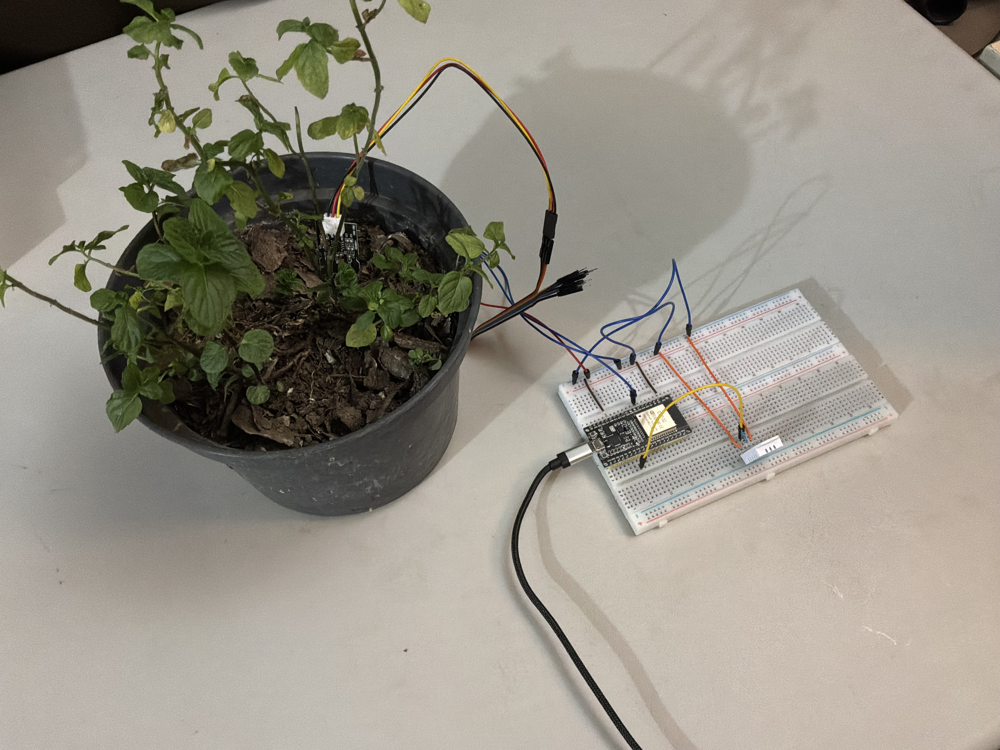
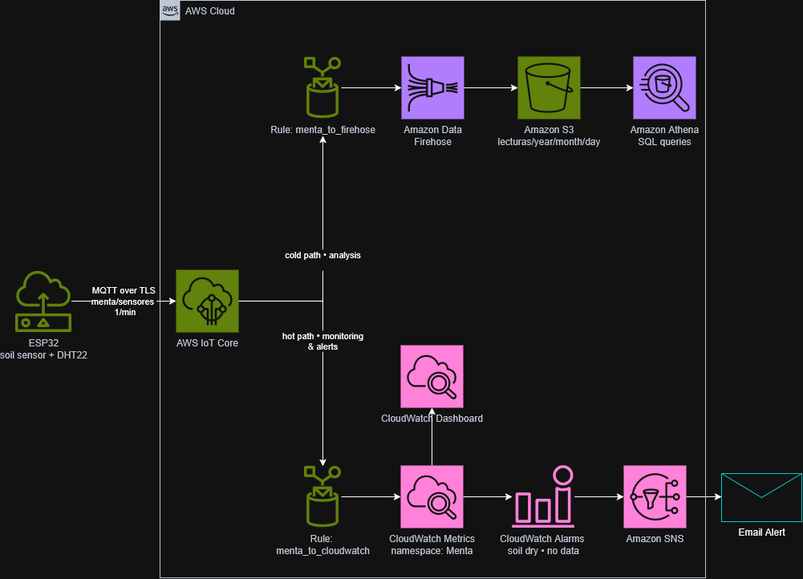
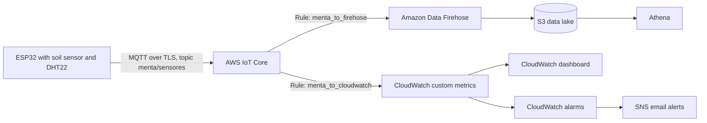
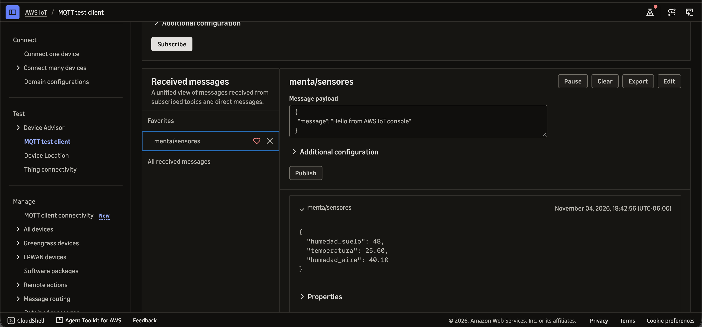
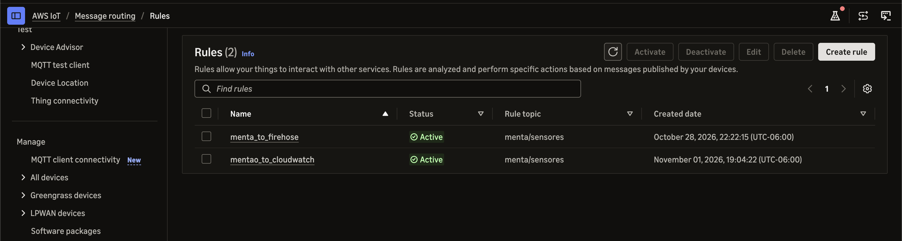
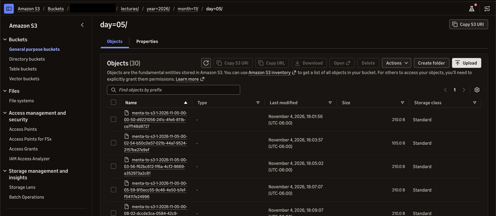
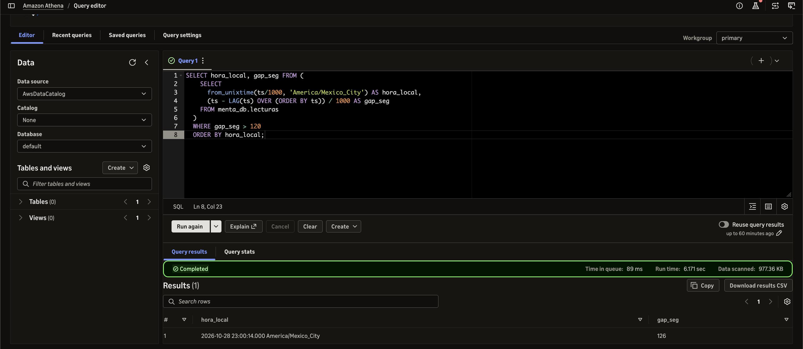
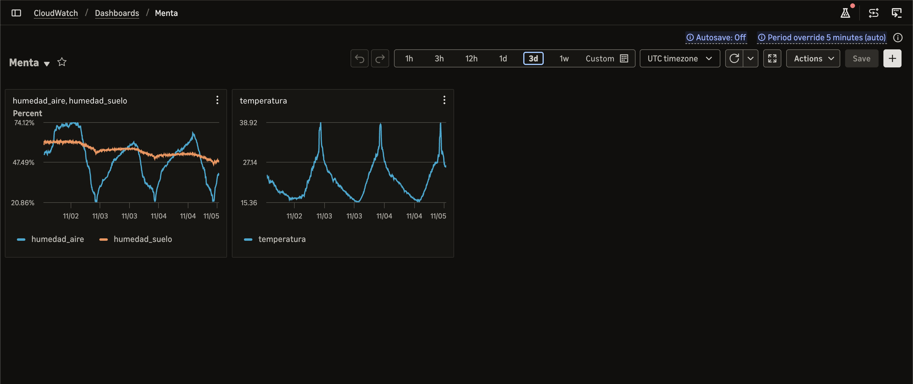
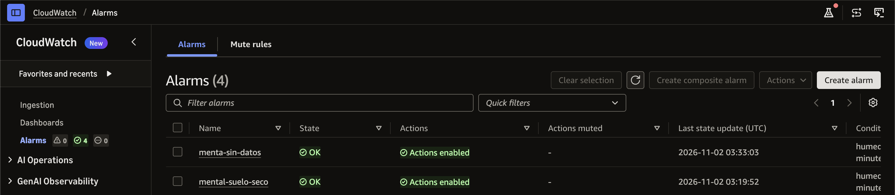
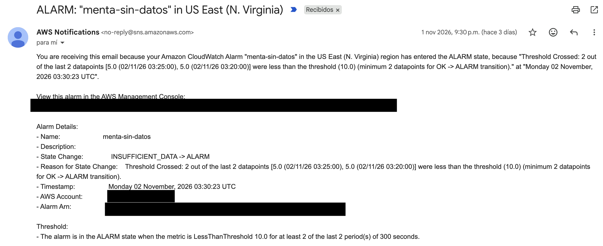

# AgTech IoT: From a Pot to Aquaponics

An end-to-end IoT monitoring system for plants, built with an ESP32 and AWS. It started with a single mint plant in a pot and is designed to scale step by step toward hydroponics, aquaponics and algae cultivation.

The goal of this project is twofold: learn how to connect real hardware to a cloud data pipeline, and build a foundation that can grow with new sensors without being redesigned each time.

## Status

| Level | Description | Status |
|---|---|---|
| 1 | Soil-based monitoring (mint plant) | Working |
| 2 | Hydroponics (water pH, EC, temperature, level) | Planned |
| 3 | Aquaponics (fish + plants, ammonia, dissolved oxygen) | Planned |
| 4 | Algae (turbidity, light, CO2) | Planned |

## What it measures (Level 1)

- Soil moisture (capacitive sensor, relative scale 0-100%)
- Air temperature
- Air relative humidity

One reading per minute is published to AWS.



## Architecture



The same flow as a text diagram:



Two paths run in parallel from the same MQTT topic:

- **Cold path (analysis):** every reading is stored in S3 as JSON lines, partitioned by date, and queried with SQL in Athena. This is where long-term history and analysis live.
- **Hot path (monitoring and alerts):** every reading is also published as a CloudWatch custom metric, which powers a live dashboard and alarms that notify by email.

## Hardware

| Component | Notes |
|---|---|
| ESP32 WROOM-32 (38 pins) | Wi-Fi + Bluetooth microcontroller |
| Capacitive soil moisture sensor v2.0 | Analog output, corrosion resistant |
| DHT22 / AM2302 | Air temperature and humidity (4-pin bare sensor) |
| 10 kOhm resistor | Pull-up between DHT22 VCC and DATA |
| 2 breadboards, jumper wires | The ESP32 is wide, so it straddles two breadboards |
| 5 V USB wall charger + micro-USB cable | Power supply for permanent installation |
| Plastic enclosure | Protects the electronics; the DHT22 stays outside |

### Wiring

| Sensor pin | ESP32 pin | Notes |
|---|---|---|
| Soil sensor VCC | 3V3 | |
| Soil sensor GND | GND | |
| Soil sensor AOUT | GPIO32 | ADC1, safe to use while Wi-Fi is active |
| DHT22 pin 1 (VCC) | 3V3 | |
| DHT22 pin 2 (DATA) | GPIO4 | 10 kOhm pull-up between VCC and DATA |
| DHT22 pin 3 | not connected | |
| DHT22 pin 4 (GND) | GND | |

Pin numbering for the DHT22 is counted left to right with the grille facing you and the pins pointing down.

Notes:

- Sensors are powered from 3.3 V, never 5 V, because the ESP32 GPIOs are not 5 V tolerant.
- GPIO32 belongs to ADC1. ADC2 pins cannot be used for analog reads while Wi-Fi is on.
- Only the sensing tip of the soil sensor goes into the soil. The DHT22 measures air and must never be buried.

## Firmware

The sketch is in [`firmware/menta_firmware`](firmware/menta_firmware).

- Connects to Wi-Fi (2.4 GHz only) and to AWS IoT Core using mutual TLS (X.509 device certificate).
- Reads both sensors and publishes a JSON message every 60 seconds:

```json
{
  "humedad_suelo": 59,
  "temperatura": 23.0,
  "humedad_aire": 52.3
}
```

- Soil calibration: raw ADC value around 3200 in air (0%) and around 900 in water (100%), mapped linearly and clamped to 0-100. This is a **relative** scale, not true volumetric water content.

### Libraries

- PubSubClient (Nick O'Leary)
- DHT sensor library (Adafruit) and Adafruit Unified Sensor
- ESP32 Arduino core (provides Wi-Fi and WiFiClientSecure)

### Secrets

Wi-Fi credentials, the AWS IoT endpoint and the device certificates are **not** in this repository. To run the firmware:

1. Copy `firmware/menta_firmware/secrets.example.h` to `firmware/menta_firmware/secrets.h`.
2. Fill in your own values.
3. `secrets.h` is listed in `.gitignore` and must never be committed.

## Cloud pipeline

Step-by-step reproducible setup, including the Athena table definition and alarm configuration, is in [`docs/aws-setup.md`](docs/aws-setup.md).

Key design points:

- The IoT rule enriches each message with `device_id` (from the MQTT client ID) and `ts` (epoch milliseconds), since the device itself does not send them.
- Firehose writes to S3 with date-based Hive-style prefixes (`lecturas/year=YYYY/month=MM/day=DD/`), and the IoT rule action uses a newline separator so every line is one JSON record.
- Athena uses partition projection, so new days appear automatically without registering partitions.
- Two alarms: soil moisture below a threshold, and "no data received" (using `SampleCount` with missing data treated as breaching).

### Example queries

Hourly averages:

```sql
SELECT date_trunc('hour', from_unixtime(ts/1000)) AS hour_utc,
       avg(humedad_suelo) AS avg_soil_pct,
       avg(temperatura)   AS avg_temp_c,
       avg(humedad_aire)  AS avg_air_pct
FROM menta_db.lecturas
GROUP BY 1
ORDER BY 1 DESC
LIMIT 24;
```

Detect gaps in the data (more than 2 minutes between readings):

```sql
SELECT hora_local, gap_seg FROM (
  SELECT
    from_unixtime(ts/1000, 'America/Mexico_City') AS hora_local,
    (ts - LAG(ts) OVER (ORDER BY ts)) / 1000 AS gap_seg
  FROM menta_db.lecturas
)
WHERE gap_seg > 120
ORDER BY hora_local;
```

## Design decisions and lessons learned

- **Time-series storage:** Amazon Timestream for LiveAnalytics was the first idea, but AWS closed it to new customers on June 20, 2025. The alternative (Timestream for InfluxDB) is instance-based and billed per hour, so an S3 + Athena data lake was a better fit for a single-sensor project and is easier to extend with new sensors.
- **Dashboards:** Amazon Managed Grafana requires IAM Identity Center, which was not available in the account used for this lab. CloudWatch dashboards and alarms cover live monitoring with no extra identity setup.
- **Schema flexibility:** storing JSON lines in S3 means adding sensors (pH, EC, dissolved oxygen) does not require changing storage.
- **Sampling rate:** soil moisture changes slowly, so one reading per minute is enough and keeps volume and cost low.
- **Microclimate:** the indoor sensor reads the air around the plant, which is what matters for the crop, not the regional weather.

More troubleshooting notes are in [`docs/troubleshooting.md`](docs/troubleshooting.md).

## Security notes

- Device certificates, private keys and Wi-Fi credentials are excluded from version control.
- Cloud-side access for reading data should follow least privilege (read-only on the data bucket and the Athena database).
- The AWS IoT policy used during early prototyping was broad. A tighter version scoped to the device client ID and topic is documented in `docs/aws-setup.md`.
- A budget alert is configured on the AWS account.
- Screenshots in `docs/images` must have account IDs and ARNs masked before publishing.

## Roadmap

- [x] Level 1 sensors, firmware and AWS ingestion
- [x] S3 data lake with Athena queries
- [x] CloudWatch dashboard and alarms with email alerts
- [ ] Firmware hardening: Wi-Fi reconnect logic and watchdog restart
- [ ] Publish the raw soil ADC value so calibration can be adjusted afterwards in SQL
- [ ] Infrastructure as code (CloudFormation, SAM or CDK) to reproduce the stack
- [ ] Grafana dashboards (self-hosted or managed)
- [ ] Derived agronomic metrics such as vapor pressure deficit (VPD)
- [ ] Level 2: hydroponics sensors (pH, EC, water temperature, level)
- [ ] Level 3: aquaponics (ammonia, dissolved oxygen)
- [ ] Level 4: algae (turbidity, light, CO2)

## First insights

Observations from the first days of data (indoor room with indirect light):

- **Daily heat peaks:** air temperature rises to almost 39 °C every afternoon while air humidity drops to around 21%. Mint prefers to stay below about 30 °C, so the next step is to check whether direct sunlight reaches the sensor or the plant at that time of day.
- **Watering rhythm:** relative soil moisture decreases slowly, from about 60% to about 50% over three days, which gives a first estimate of how often the plant needs water.

These are early observations from a single plant and a single location, not conclusions.

## Screenshots

**Messages arriving in AWS IoT Core (MQTT test client)**


**IoT rules routing the same topic to two paths**


**S3 data lake partitioned by date**


**Athena query detecting gaps in the data** (the single gap is when the device was moved)


**CloudWatch dashboard (3 days)**


**CloudWatch alarms**


**Alert email from a test run with a temporary threshold**


## License

To be decided. MIT is a common choice for sample code.
